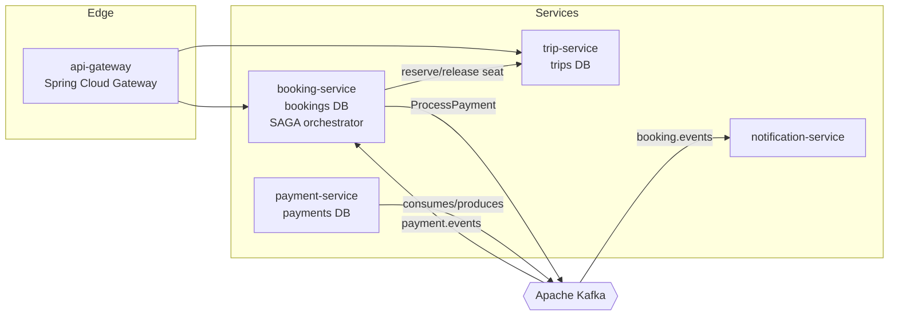
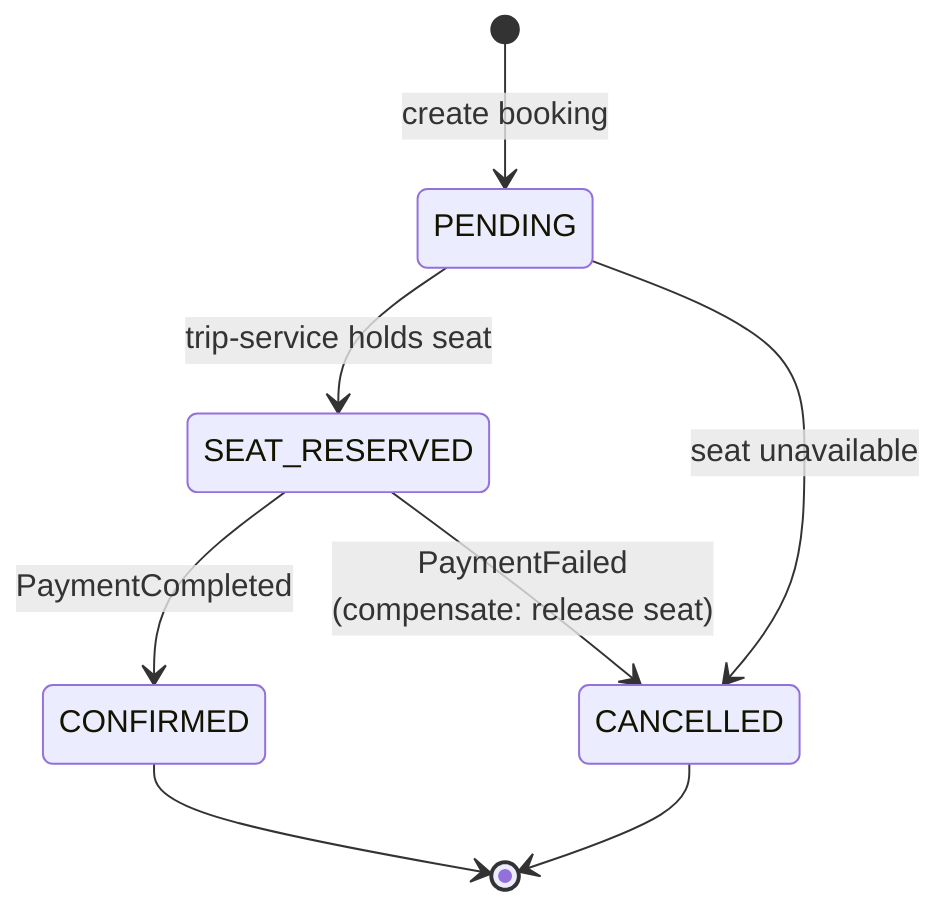
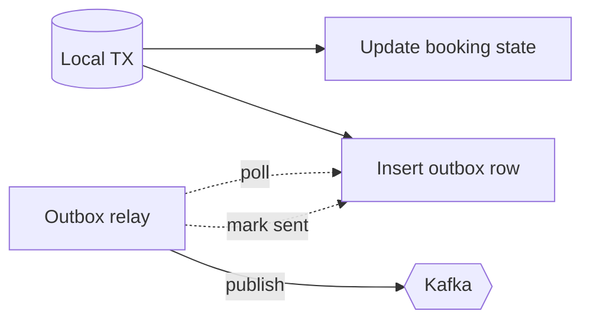
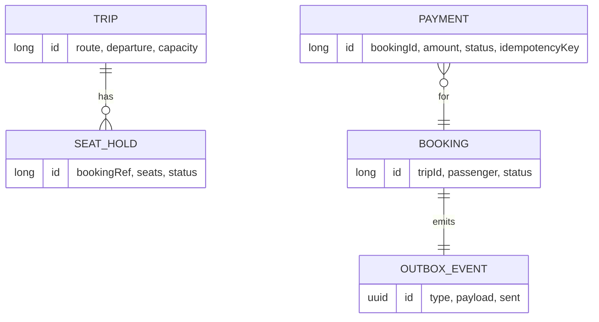

# TransitFlow — Architecture

This document explains **how** TransitFlow is built and, more importantly, **why**. The guiding constraint is the one that defines distributed systems: each service owns its data, and there is no shared database transaction spanning services. Every decision below follows from that.

## 1. Context

TransitFlow lets passengers book seats on scheduled trips and pay for them. A single booking touches three bounded contexts:

- **Trips** — what seats exist and whether they're available.
- **Bookings** — the passenger's intent and its lifecycle.
- **Payments** — money, which can succeed or fail.

These are separate services with separate databases. The challenge is making a booking *atomic from the passenger's point of view* while each service commits only to its own database.

## 2. Communication styles — and when we use each

We deliberately mix two styles:

| Style | Used for | Why |
|-------|----------|-----|
| **Synchronous REST** | `booking → trip` seat reservation | The booking cannot proceed without a confirmed seat hold. We need an immediate yes/no, and the operation is naturally request/response. |
| **Asynchronous events (Kafka)** | payment flow, notifications | Payment is slow and can fail; the passenger shouldn't hold a connection open for it. Notifications are fire-and-forget. Decoupling here buys resilience and independent scaling. |

> **Trade-off:** the synchronous seat reservation introduces temporal coupling between `booking` and `trip`. We accept it because a seat hold must be immediate and strongly consistent; we isolate the blast radius with a timeout and treat a reservation failure as a terminal booking failure (no SAGA needed).

## 3. The consistency problem and the SAGA solution

A booking that reserves a seat **and** charges a card spans two services' databases. A distributed transaction (2PC) would couple their availability and doesn't scale. Instead we use an **orchestrated SAGA**: a sequence of local transactions, each with a **compensating action** that semantically undoes it.

`booking-service` is the orchestrator. It owns the state machine:

**Why orchestration over choreography?** With only a few steps and a clear owner of the booking lifecycle, a central orchestrator makes the flow explicit, debuggable, and easy to extend. Pure choreography (each service reacting to the previous one's events) spreads the business process across services and becomes hard to reason about as steps grow. See [ADR-0003](docs/adr/0003-saga-orchestration-over-choreography.md).

## 4. Reliable event publishing — the outbox pattern

The orchestrator must do two things when a booking changes: **persist the new state** and **publish an event**. If it writes to the DB and then publishes to Kafka as two separate operations, a crash in between leaves them inconsistent — a lost event, or an event for a change that rolled back.

The **transactional outbox** fixes this: the event is inserted into an `outbox` table **in the same local transaction** as the state change. A separate relay polls the outbox and publishes to Kafka, marking rows as sent. The DB transaction is the single source of truth; Kafka eventually catches up.

See [ADR-0004](docs/adr/0004-transactional-outbox.md).

## 5. Idempotent consumers

Kafka guarantees **at-least-once** delivery: a consumer can see the same message twice (e.g. after a rebalance before the offset commits). Charging a card twice is unacceptable. Every consumer that performs a side effect is **idempotent**: it records the processed message/idempotency key and short-circuits duplicates. `payment-service` keys idempotency on the booking id so a redelivered `ProcessPayment` returns the original result instead of charging again. See [ADR-0005](docs/adr/0005-idempotent-consumers.md).

## 6. Poison messages and dead-letter queues

A message that always fails to process (bad schema, unresolvable reference) must not block the partition forever. Consumers apply a bounded retry with backoff, then route the message to a **dead-letter topic** (`<topic>.DLT`) for inspection and manual replay, keeping the main flow healthy.

## 7. Data ownership

No service reads another's tables. `trip-service` never sees a `payment` row; it only knows a seat was reserved against a booking reference. This is what lets each service evolve, deploy, and scale independently.

## 8. Observability

Every service exposes Spring Boot Actuator (`/actuator/health`, `/actuator/prometheus`). A **correlation id** is generated at the gateway and propagated through REST headers and Kafka message headers, so a single booking can be traced across all services in logs.

## 9. Deliberate non-goals

To keep the codebase readable, the following are **documented but not implemented** (see the roadmap in the README):

- **Schema registry / Avro** — events are JSON; a real platform would enforce contracts with a registry.
- **Distributed tracing backend** — correlation ids are propagated, but there's no Tempo/Jaeger wiring.
- **Exactly-once Kafka semantics** — we rely on idempotent consumers instead, which is the pragmatic industry default.

Calling these out explicitly is itself the point: a staff-level system is defined as much by the trade-offs it *names* as by the code it ships.
