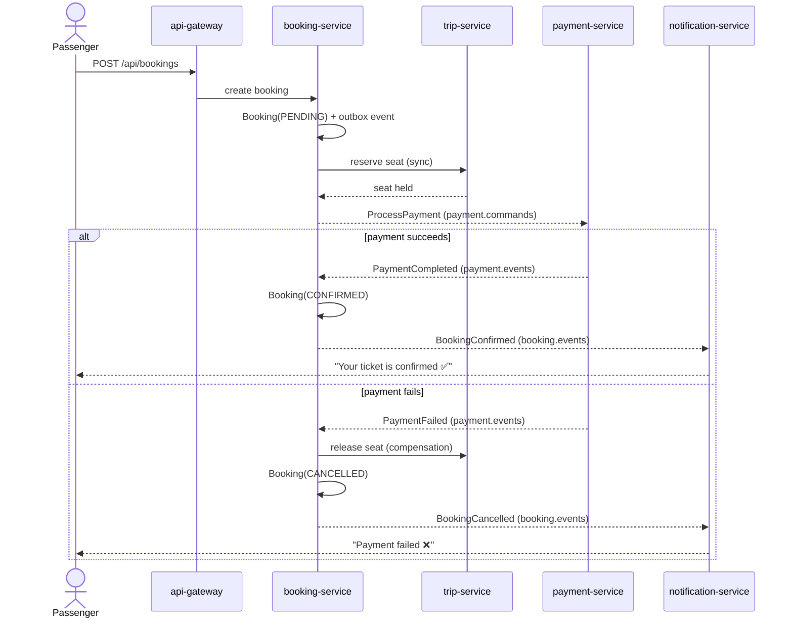

<div align="center">

# 🚍 TransitFlow

**An event-driven transit ticketing platform — microservices, Kafka, and the SAGA pattern, built to production-grade standards.**

Buy tickets, reserve seats, and process payments across a choreography of independent services that stay consistent **without distributed transactions** — using an orchestrated SAGA with compensation, the transactional outbox pattern, idempotent consumers, and dead-letter queues.


</div>

---

## Why this project exists

Most "microservices demo" repos are a REST monolith split into folders. This one models the hard part of distributed systems: **keeping data consistent across services that each own their own database, when there is no shared transaction**.

The booking flow spans three services and a payment that can fail. TransitFlow solves it the way real platforms do — with an **orchestrated SAGA** and **compensating actions**, reliable event publishing via the **outbox pattern**, and **idempotent consumers** so that a redelivered Kafka message never double-charges a passenger.

> 📐 Read **[ARCHITECTURE.md](ARCHITECTURE.md)** for the full design, diagrams, and trade-offs, and **[docs/adr/](docs/adr/)** for the architecture decision records.

## The booking SAGA, in one picture



## Services

| Service | Port | Owns | Responsibility |
|---------|------|------|----------------|
| `api-gateway` | 8080 | — | Single entry point; routes to services (Spring Cloud Gateway) |
| `trip-service` | 8081 | `trips` DB | Routes, schedules, seat inventory; reserve/release seats |
| `booking-service` | 8082 | `bookings` DB | **SAGA orchestrator**; owns booking lifecycle + outbox |
| `payment-service` | 8083 | `payments` DB | Idempotent payment processing; emits payment events |
| `notification-service` | 8084 | — | Consumes terminal events; notifies passengers; DLQ handling |

## Run it

Everything — services, Kafka, and one PostgreSQL per service — comes up with a single command. No local JDK or Maven required (services build inside multi-stage Docker images).

```bash
docker compose up --build
```

> **Note (corporate networks / TLS inspection):** the service images build with Maven *inside* the container. If your network inspects TLS, the in-container build can't validate Maven Central's certificate (`PKIX path building failed`). Either build the jars on the host first — `mvn -DskipTests package` in each service, using `MAVEN_OPTS="-Djavax.net.ssl.trustStoreType=WINDOWS-ROOT"` on Windows so Maven trusts the OS certificate store — or mount your corporate root CA into the build. On an unrestricted network (and in CI) `docker compose up --build` works as-is.

Then exercise the flow:

```bash
# 1. List available trips
curl http://localhost:8080/api/trips

# 2. Book a seat (triggers the SAGA)
curl -X POST http://localhost:8080/api/bookings \
  -H 'Content-Type: application/json' \
  -d '{"tripId": 1, "passengerName": "Ada Lovelace", "seatCount": 1}'

# 3. Poll the booking until it reaches CONFIRMED (or CANCELLED)
curl http://localhost:8080/api/bookings/{id}
```

> 💡 The payment service **deterministically fails** payments above a configurable amount so you can watch the **compensation path** (seat release + booking cancellation) end to end.

## What this repo demonstrates

- **Database-per-service** with no shared schema — services integrate only through events and well-defined APIs.
- **Orchestrated SAGA** with explicit compensation, instead of a two-phase commit that doesn't scale.
- **Transactional outbox** — business state and the "event to publish" are committed in the *same* local transaction, so an event is never lost or published for a rolled-back change.
- **Idempotent consumers** keyed on an idempotency token — safe under Kafka's at-least-once delivery.
- **Dead-letter queues** for poison messages, with a retry/backoff policy.
- **Correlation IDs** propagated across services for traceable, debuggable flows.
- **Observability** via Spring Boot Actuator (health, metrics, Prometheus endpoint).

## Tech

**Language:** Java 21 · **Framework:** Spring Boot 3.3, Spring Kafka, Spring Data JPA, Spring Cloud Gateway
**Infra:** Apache Kafka (KRaft mode) · PostgreSQL · Docker Compose
**Build:** Maven (multi-stage Docker builds)

## Roadmap

- [ ] Contract tests between producers and consumers (schema registry + Avro)
- [ ] Distributed tracing with OpenTelemetry + Tempo
- [ ] Grafana/Prometheus dashboards for SAGA latency and DLQ depth
- [ ] Kubernetes manifests + Helm chart

## License

MIT — see [LICENSE](LICENSE).
